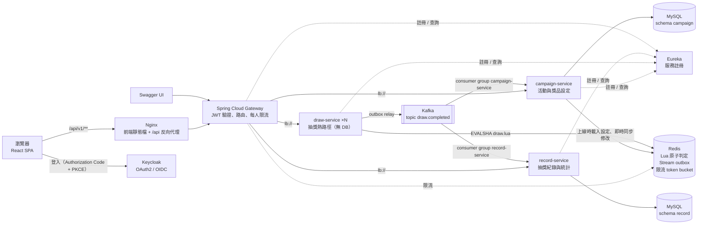
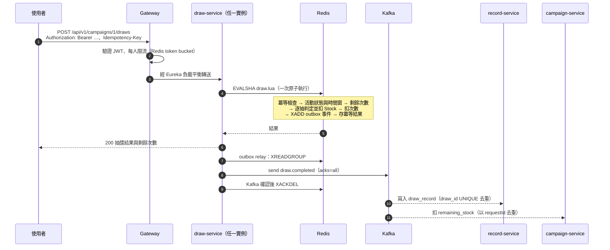

# SpinToWin：電商轉盤抽獎系統

一套前後端分離、可水平擴展的轉盤抽獎系統。營運人員（ADMIN）在管理後台設定抽獎活動、獎品、庫存與中獎機率；使用者（USER）登入後可單抽或一次連抽最多 10 次。高併發下保證**不超抽庫存、不超用次數、重送不重複扣**。

- 後端：Java 21、Spring Boot 4.2、Spring Cloud（Gateway、Eureka）、Redis Lua、Kafka、MySQL、Keycloak
- 前端：React 19 + TypeScript + Vite
- 一行 `docker compose up` 啟動全部元件，`--scale` 擴展服務實例

文件：

- [API 說明文件](docs/api.md)：每個路由的角色、參數、範例請求與回應、錯誤碼對照表
- [Table Schema](docs/schema/README.md)：ER 圖、[campaign schema DDL + DML](docs/schema/campaign.sql)、[record schema DDL + DML](docs/schema/record.sql)
- 執行中的系統另有 Swagger UI（見[網址](#網址)）

---

## 目錄

- [名詞](#名詞)
- [架構](#架構)
- [技術棧](#技術棧)
- [啟動方式](#啟動方式)
- [預建帳號與網址](#預建帳號與網址)
- [執行測試](#執行測試)
- [設計重點](#設計重點)
- [題目要求對照](#題目要求對照)
- [Production 部署建議](#production-部署建議)
- [已知限制](#已知限制)
- [專案結構](#專案結構)

---

## 名詞

| 名詞 | 說明 |
|---|---|
| Campaign（抽獎活動） | 一場獨立的轉盤抽獎，有自己的獎品組合、時間窗（`startAt`～`endAt`）與每人抽獎次數上限。 |
| Campaign Status | `DRAFT`（草稿）→ `ACTIVE`（上線，時間窗內可抽）→ `ENDED`（已結束），只能往前。 |
| Prize（獎品） | Campaign 中可抽中的獎項，有名稱、Stock 與 Win Probability。 |
| Stock（庫存） | Prize 尚可被抽出的剩餘數量。 |
| Win Probability（中獎機率） | 單次抽獎抽中某個 Prize 的機率，以百分比設定（最多 4 位小數），內部以整數 ppm（百萬分率，1,000,000 = 100%）計算。 |
| 銘謝惠顧 | 沒有抽中任何 Prize。機率 = 100% − 所有 Prize 機率總和，自動計算；抽中 Stock 為 0 的 Prize 時也改判銘謝惠顧。 |
| Draw（抽獎） | 轉一次轉盤，產生一個 Draw Result（抽中某個 Prize 或銘謝惠顧）。 |
| Multi-Draw（連抽） | 一次請求連抽 N 次（1～10），每次獨立判定；剩餘次數不足 N 時整筆拒絕。 |
| Draw Quota（抽獎次數上限） | Campaign 設定的每位使用者最多可抽次數。 |

---

## 架構



一次抽獎的流程：



### 服務職責

| 服務 | 職責 | 資料 |
|---|---|---|
| `gateway` | 唯一入口（前綴 `/api/v1`）；驗證 JWT；經 Eureka 路由並負載平衡；抽獎 API 每位使用者限流；匯集各服務 OpenAPI 為單一 Swagger UI | Redis（限流） |
| `discovery` | Eureka Server | — |
| `campaign-service` | Campaign 與 Prize 的設定與驗證；上線時把活動載入 Redis，上線期間的修改即時同步；消費 `draw.completed` 更新 MySQL 的剩餘 Stock；從 MySQL 重建 Redis | MySQL `campaign` schema、Redis |
| `draw-service` | 抽獎熱路徑：呼叫 Redis Lua 判定；outbox relay 把事件轉送 Kafka。**不連 MySQL、無狀態** | Redis |
| `record-service` | 消費 `draw.completed` 寫入每一抽的紀錄；提供「我的紀錄」與後台統計 | MySQL `record` schema |
| `frontend` | Nginx 提供 React SPA，並把 `/api` 反向代理到 gateway（同源，不需 CORS） | — |

---

## 技術棧

| 類別 | 技術與版本 |
|---|---|
| 語言 / 執行環境 | Java 21（Eclipse Temurin 21.0.13）、Node.js 24 |
| 後端框架 | Spring Boot 4.2.0、Spring Cloud 2026.0.0（Gateway WebFlux、Netflix Eureka）、Spring Security OAuth2 Resource Server、Spring Data JPA、Spring Data Redis、Spring for Apache Kafka、Flyway、springdoc-openapi 3.2.1 |
| 建置 | Maven 3.9.16（wrapper `mvnw`），multi-module |
| 資料與訊息 | MySQL 8.4.13、Redis 8.10.3（AOF `everysec`）、Apache Kafka 4.4.0（KRaft） |
| 身分驗證 | Keycloak 26.8.2（realm 啟動時自動匯入） |
| 前端 | React 19.3.1、React Router 8.5.1、TypeScript 6.0.3、Vite 8.3.6、keycloak-js 26.2.5、Nginx 1.30.7 |
| 測試 | JUnit 5、AssertJ、Mockito、Spring MockMvc / WebTestClient、Testcontainers（MySQL、Redis、Kafka）、Vitest 5.1.0、Testing Library |
| 部署 | Docker Compose |

---

## 啟動方式

### 需求

- Docker Desktop（或 Docker Engine + Compose v2），建議分配 6 GB 以上記憶體
- 第一次啟動會在容器內以 Maven 與 npm 建置映像檔（需要網路，約數分鐘），本機不必安裝 JDK 或 Node.js
- **Redis 需為 8.2 以上**：outbox relay 使用 `XACKDEL`（Redis 8.2 新增）。compose 已固定 `redis:8.10.3-alpine`；若改接外部 Redis 請確認版本。

### 一行啟動

```bash
cd infra
docker compose up -d --build --wait
```

所有容器會依 healthcheck 與 `depends_on: service_healthy` 的順序啟動，全部 healthy 後指令才結束。完成後開啟 <http://localhost>，以下方帳號登入即可抽獎。

範例資料：Flyway 會建立一個 ACTIVE 的 Campaign（id `1`，「週年慶轉盤抽獎」，每人 10 次），含 3 個 Prize：藍牙耳機 1%（Stock 10）、100 元購物金 9.5%（Stock 200）、免運券 30%（Stock 1000），銘謝惠顧 59.5%。campaign-service 啟動時會把它載入 Redis。

### 水平擴展

後端服務不對外開 port（只經 gateway 存取），可直接擴展：

```bash
docker compose up -d --wait --scale draw-service=3
```

新實例向 Eureka 註冊後，gateway 會在數秒內開始把請求輪流分給各實例。`record-service` 與 `campaign-service` 也可擴展（Kafka consumer 的上限是 partition 數，預設 6）。

### 停止

```bash
docker compose down       # 保留資料（named volumes）
docker compose down -v    # 清除所有資料，下次啟動重新建立 schema、範例資料與 Keycloak realm
```

### Port 被占用時

所有設定都有預設值，`.env` 可省略。若本機的 3306、6379、80、8080 等 port 已被其他程式占用，複製範例後修改對外 port：

```bash
cd infra
cp .env.example .env
```

```dotenv
# infra/.env
MYSQL_PORT=13306
REDIS_PORT=16379
```

| 變數 | 預設 | 注意 |
|---|---|---|
| `FRONTEND_PORT` | 80 | Keycloak 的 `spintowin-frontend` client 只允許 `http://localhost/*` 與 `http://localhost:5173/*` 作為 redirect URI；改成其他 port 時要在 Keycloak 的 client 設定加上對應網址（`infra/keycloak/realm-spintowin.json`）。 |
| `GATEWAY_PORT` | 8000 | Swagger UI 的登入 redirect URI 綁定 8000；改了之後網站照常運作，只有 Swagger UI 內登入需在 Keycloak 加上新的 redirect URI。 |
| `KEYCLOAK_PORT` | 8080 | 要一併修改 `KEYCLOAK_PUBLIC_URL`（例如 `http://localhost:18080`），它是 token 的 `iss`，前端也以它導向登入頁。 |
| `MYSQL_PORT`、`REDIS_PORT`、`KAFKA_PORT`、`DISCOVERY_PORT` | 3306、6379、9092、8761 | 只影響本機連線；容器之間一律走內部網路。 |

其他可調參數（DB 帳密、限流速率、topic partition 數、JVM 參數）見 [`infra/.env.example`](infra/.env.example)。

### 本機開發前端（選用）

compose 啟動後，前端可另以 Vite dev server 執行（`/api` 代理到 `http://localhost:8000`）：

```bash
cd frontend
npm ci
npm run dev   # http://localhost:5173
```

---

## 預建帳號與網址

### 帳號（Keycloak realm `spintowin`，帳號 = 密碼）

| 帳號 | 密碼 | 角色 | 可以做什麼 |
|---|---|---|---|
| `admin` | `admin` | ADMIN、USER | 管理後台（活動、獎品、上線／結束、庫存、統計），也可以抽獎 |
| `user1` | `user1` | USER | 抽獎、查剩餘次數與自己的紀錄 |
| `user2` | `user2` | USER | 同上 |
| `user3` | `user3` | USER | 同上 |

Keycloak 管理主控台（master realm）：`admin` / `admin`。

### 網址

| 用途 | 網址 |
|---|---|
| 網站（轉盤、我的紀錄、管理後台） | <http://localhost>（轉盤：`/campaigns/1`，後台：`/admin`） |
| Swagger UI（匯集三個服務的 OpenAPI，可用 Keycloak 登入後試打） | <http://localhost:8000/swagger-ui.html> |
| API（gateway） | `http://localhost:8000/api/v1/...` 或經網站同源的 `http://localhost/api/v1/...` |
| Keycloak | <http://localhost:8080>（管理主控台 `/admin`） |
| Eureka dashboard | <http://localhost:8761> |

### 用 curl 試打

realm 另有一個 **僅供開發** 的 `spintowin-cli` client（password grant），方便命令列取得 token：

```bash
TOKEN=$(curl -s -X POST http://localhost:8080/realms/spintowin/protocol/openid-connect/token \
  -d grant_type=password -d client_id=spintowin-cli -d username=user1 -d password=user1 \
  | python -c "import sys,json;print(json.load(sys.stdin)['access_token'])")

curl -s http://localhost:8000/api/v1/campaigns/1/me -H "Authorization: Bearer $TOKEN"

curl -s -X POST http://localhost:8000/api/v1/campaigns/1/draws \
  -H "Authorization: Bearer $TOKEN" \
  -H "Idempotency-Key: $(uuidgen)" \
  -H "Content-Type: application/json" \
  -d '{"count":3}'
```

完整 API 見 [docs/api.md](docs/api.md)。

---

## 執行測試

後端（需要 Docker：整合測試以 Testcontainers 啟動真的 MySQL、Redis、Kafka）：

```bash
cd backend
./mvnw -B test                               # Windows：mvnw.cmd -B test
./mvnw -B test -pl draw-service -am          # 只跑單一服務
```

前端：

```bash
cd frontend
npm ci
npm test
```

測試的切入點與重點：

| 範圍 | 測試 | 驗證內容 |
|---|---|---|
| 抽獎判定（draw-service + 真 Redis） | `DrawServiceTest` | 以固定的隨機數序列驗證 ppm 區間邊界（0、999,999、區間交界前後一點）、Stock 為 0 改判銘謝惠顧、連抽中途 Stock 用完、次數不足整筆拒絕且不扣任何東西、時間窗與 Campaign Status、冪等重送回傳相同結果且只扣一次 |
| 機率分布 | `DrawDistributionTest` | 以 `SecureRandom` 抽 10 萬次，卡方檢定（α = 0.001）各 Prize 與銘謝惠顧的實際分布符合設定機率 |
| 併發 | `DrawConcurrencyTest` | 1000 個執行緒搶 Stock 10 的 Prize 剛好抽出 10 個；同一使用者併發單抽、連抽都不超過 Draw Quota；同一 Idempotency-Key 併發重送只扣一次 |
| 事件 | `OutboxRelayTest`、`DrawCompletedConsumerTest`、`RemainingStockConsumerTest` | outbox 事件內容、Kafka 暫停後重送、崩潰實例的事件被接手；消費端重複投遞只寫一次／只扣一次、壞訊息進 dead-letter topic |
| HTTP API（各服務 + 真 MySQL） | `*ApiTest` | 機率總和驗證、狀態轉換、上線同步 Redis、Stock 增減與負數拒絕、分頁與統計、RFC 9457 錯誤格式、欄位驗證錯誤、401 與 403 |
| Gateway | `GatewayApiTest`、`DrawRateLimitApiTest`、`SwaggerUiApiTest` | 路由、JWT 驗證（含 `iss` 比對）、每人限流 429、Swagger UI 公開 |
| 純邏輯 | `PpmTest`、`ProbabilitySumTest`、`CampaignTest` | 百分比 ↔ ppm 轉換與精度、機率總和上限、狀態轉換規則 |
| 前端（Vitest） | `wheelSlices`、`wheelLanding`、`WheelPage.draw`、`AdminCampaignPage` 等 | 轉盤扇形與停格角度對應抽中結果、連抽逐一播放、錯誤訊息、後台機率即時檢查 |

---

## 設計重點

### 1. 抽獎判定：Redis 單一 Lua script 原子執行

熱門活動時，大量使用者同時搶同一個 Prize 的 Stock。若以資料庫行鎖或條件式 `UPDATE` 扣庫存，同一列會成為全域熱點，服務再怎麼擴展瓶頸都在資料庫；若「Redis 判定 + 同步寫 DB」，每次抽獎仍要等 DB 交易。

因此抽獎的「檢查 → 判定 → 扣減」整段放在 Redis 的一個 Lua script（`draw-service/src/main/resources/redis/draw.lua`）中執行。Redis 以單執行緒執行整個 script，中間不會插入其他請求，所以**絕不超抽、絕不超次數**，也不需要分散式鎖。script 依序：

1. 以 `Idempotency-Key` 查先前結果，有就直接回傳（不扣任何東西）。
2. 檢查 Campaign 為 `ACTIVE`，且 Redis `TIME`（所有實例共用同一個時鐘）落在 `startAt`～`endAt`。
3. 剩餘次數 < `count` 時整筆拒絕，不扣任何東西。
4. 每一抽以 draw-service 產生的 `SecureRandom` 落點 r ∈ [0, 1,000,000) 在 ZSET（各 Prize 依序累加的 ppm 上界）中找到 Prize；Stock > 0 就扣 1，否則改判銘謝惠顧。
5. 扣已用次數。
6. `XADD` 事件到該 Campaign 的 outbox stream。
7. 存冪等結果（TTL 24 小時）並回傳。

機率以整數 ppm 計算，避免浮點誤差；隨機數來源是可替換的介面，測試可注入固定序列驗證邊界。

代價是 MySQL 只有最終一致：活動期間 **Redis 是 Stock 與已用次數的即時依據**，MySQL 是事後的持久副本。因此 Redis 開啟 AOF 持久化，並提供從 MySQL 重建 Redis 的管理 API（`POST /admin/campaigns/{id}/redis/rebuild`）。

### 2. 不遺失結果：Redis Stream outbox → Kafka

「Redis 扣了 Stock，但事件沒送到 Kafka」是典型的 dual-write 問題：若 Lua 成功後才同步送 Kafka，在送出前崩潰就會遺失抽獎結果。

本系統讓 Lua 在**扣減的同一個原子操作中**把事件 `XADD` 到 Redis Stream（outbox），所以「扣了 Stock 卻沒有事件」不會發生。draw-service 內的 outbox relay 以 Redis consumer group 讀取（所有實例共用一個 group，自然分工），Kafka 以 `acks=all` 確認寫入後才以 `XACKDEL` 確認並刪除；崩潰實例未確認的事件會被其他實例以 `XCLAIM` 接手重送。Kafka 暫時無法連線時抽獎照常進行，事件留在 Redis 等待重送。無法解析的 outbox 事件記 ERROR 後移到 `campaign:{id}:outbox:dead` stream，不會卡住同一 Campaign 的其他事件。

投遞因此是 at-least-once，消費端必須冪等：

- record-service：`draw_record.draw_id` UNIQUE，`INSERT … ON DUPLICATE KEY UPDATE` 讓重複事件成為 no-op。
- campaign-service：`processed_draw_event`（以 `requestId` 為主鍵）與扣減 `remaining_stock` 在同一個交易中寫入，重複事件不會重複扣。
- 無法解析或內容不合法的訊息不重試，直接送各消費端自己的 dead-letter topic（`draw.completed.record-service.DLT`、`draw.completed.campaign-service.DLT`），保留原始內容與例外 header，修正後可重新投遞（消費端冪等）；資料庫暫時性錯誤則持續退避重試，不會跳過。

不直接以 Redis Stream 取代 Kafka，是為了保留 Kafka 的多消費者（record-service、campaign-service 各自一個 consumer group）與重播能力。

### 3. 依寫入模式拆分微服務

切分依據不是業務名詞，而是**寫入頻率與一致性需求**：

- 活動設定：低頻、需強一致 → `campaign-service`（MySQL 交易 + 悲觀鎖，寫入後同步 Redis，失敗時補償）。
- 抽獎：極高頻、只依賴 Redis → `draw-service`，**不連 MySQL、無狀態**，擴展它不會增加資料庫連線壓力。
- 紀錄落庫：可最終一致 → `record-service`，消費 Kafka。

每個服務在同一個 MySQL instance 中擁有自己的 schema，不跨 schema 存取，只經 API 或 Kafka 溝通；跨服務只以 id 參照（例如 `draw_record.campaign_id`），沒有跨 schema 外鍵。服務透過 Eureka 註冊，gateway 以 `lb://服務名稱` 負載平衡，所以 `--scale` 後不需要任何設定變更。

### 4. 身分驗證與權限：Keycloak（OAuth2 / OIDC）

使用者登入、密碼與角色交給 Keycloak，後端各服務只當 OAuth2 Resource Server 驗證 JWT，不自建帳號系統，微服務之間也不必共享 session。

- 前端：keycloak-js，Authorization Code + PKCE（public client）。Swagger UI 也以同樣方式登入。
- gateway 先驗證 token（簽章、效期、`iss`），各服務再驗證一次並做角色授權：`/campaigns/**` 需要 `USER`，`/admin/**` 需要 `ADMIN`。
- 使用者 id 一律取自 token 的 `sub`，API 不接受由使用者傳入的 user id，所以看不到別人的紀錄。
- 容器內以 `http://keycloak:8080` 取公鑰、但 token 的 `iss` 是瀏覽器看到的 `http://localhost:8080`：各服務同時設定 `issuer-uri`（只用來比對 `iss`）與 `jwk-set-uri`（實際取公鑰）。

### 5. 防重複抽獎與限流

- **冪等**：抽獎 API 必須帶 `Idempotency-Key`。前端每次按下抽獎產生一個 UUID，網路重試沿用同一個 key；Redis 以 (Campaign, 使用者, key) 保存結果 24 小時，重送回傳完全相同的回應，不會重複扣次數。
- **限流**：gateway 以 Redis token bucket 對每位使用者（JWT `sub`）限制抽獎 API 每秒 5 次，超過回 `429 RATE_LIMITED` 與 `Retry-After`。
- **次數上限**：由 Lua 原子檢查，連抽不足時整筆拒絕。

### 6. 動態配置

- 上線前（DRAFT）可任意修改活動與獎品；上線條件為至少一個 Prize、機率總和 ≤ 100%。
- 上線期間（ACTIVE）可修改 Prize 名稱、機率，以及以**增減量**調整 Stock（`PATCH …/stock {"delta": 50}`）。以增減量而非覆寫，是為了不蓋掉同時間被抽走的數量；增減以 Redis 的即時剩餘量判定，不會變負數。
- 修改先寫 MySQL（同一個交易內持有 Campaign 列鎖），最後才寫 Redis；交易回滾時以補償還原 Redis。修改對之後的抽獎立即生效。
- 機率總和不會超過 100%（新增、修改時都驗證），銘謝惠顧自動為剩餘機率。

### 7. 錯誤處理與輸入驗證

- 所有錯誤（包含 gateway 的 401、429）都是 RFC 9457 Problem Details（`application/problem+json`），另加機器可讀的 `code` 與欄位錯誤 `errors[]`。
- 輸入以 Jakarta Bean Validation 驗證，錯誤回 `400 VALIDATION_FAILED` 並列出每個欄位。
- 業務規則錯誤以專屬錯誤碼回應（`QUOTA_EXCEEDED`、`PROBABILITY_SUM_EXCEEDED`、`STOCK_NEGATIVE`…），見 [錯誤碼對照表](docs/api.md#錯誤碼)。

### 8. 多環境設定

- Spring profile：`local`（預設，連 localhost）、`docker`（compose 主機名稱）、`prod`（連線資訊沒有預設值，缺少就啟動失敗）。
- DataSource、HikariCP 連線池、Redis、Kafka、Keycloak、Eureka 全部以 `${ENV:預設值}` 注入，同一個映像檔可部署到任何環境。例如：

| 環境變數 | 說明 |
|---|---|
| `SPRING_PROFILES_ACTIVE` | `local` / `docker` / `prod` |
| `DB_URL`、`DB_USERNAME`、`DB_PASSWORD` | DataSource |
| `DB_POOL_MAX_SIZE`、`DB_POOL_MIN_IDLE`、`DB_POOL_CONNECTION_TIMEOUT_MS`、`DB_POOL_IDLE_TIMEOUT_MS`、`DB_POOL_MAX_LIFETIME_MS` | HikariCP 連線池 |
| `REDIS_HOST`、`REDIS_PORT`、`REDIS_PASSWORD`、`REDIS_TIMEOUT_MS` | Redis |
| `KAFKA_BOOTSTRAP_SERVERS`、`KAFKA_DRAW_COMPLETED_PARTITIONS`、`KAFKA_DRAW_COMPLETED_REPLICAS` | Kafka |
| `KEYCLOAK_ISSUER_URI`、`KEYCLOAK_JWK_SET_URI` | JWT 驗證 |
| `EUREKA_URL` | 服務註冊 |
| `DRAW_RATE_LIMIT_REPLENISH_RATE`、`DRAW_RATE_LIMIT_BURST_CAPACITY` | 抽獎限流 |

---

## 題目要求對照

| 題目 | 要求 | 實作方式 | 位置 |
|---|---|---|---|
| A1 | 多種獎品，可設定數量（庫存）與中獎機率 | Prize 不限數量，各有 Stock 與 Win Probability（百分比，最多 4 位小數，內部 ppm） | `POST /admin/campaigns/{id}/prizes`；`prize` 表 |
| A1 | 銘謝惠顧與各獎品機率總和為 100% | 銘謝惠顧 = 100% − 獎品機率總和，自動計算；任何使總和超過 100% 的修改回 `409 PROBABILITY_SUM_EXCEEDED` | `ProbabilitySum`、`noWinProbability` 欄位 |
| A1 | 獎品內容可動態配置 | 上線前可增刪改；上線期間可改名稱、機率與增減 Stock，即時同步 Redis，對之後的抽獎立即生效 | `AdminPrizeService`、`LiveCampaignSync` |
| A2 | 單次抽獎與多次連續抽獎 | `POST /campaigns/{id}/draws` body `{"count": 1..10}`，每抽獨立判定 | `DrawController`、`draw.lua` |
| A2 | 不同活動各自的抽獎次數上限 | Campaign 的 `drawQuota` | `campaign.draw_quota` |
| A3 | 同一使用者不可超出允許次數 | Lua 原子檢查剩餘次數，不足整筆拒絕 `409 QUOTA_EXCEEDED`；`Idempotency-Key` 防止重送重複扣；gateway 每人限流 | `draw.lua`、`DrawConcurrencyTest` |
| A3 | 防止獎品超過庫存被抽取 | Lua 原子檢查並扣 Stock，Stock 為 0 改判銘謝惠顧；1000 執行緒搶 10 個 Stock 的測試 | `draw.lua`、`DrawConcurrencyTest` |
| B1 | 高可用、可水平擴展的分散式架構 | 微服務 + Eureka + Gateway 負載平衡；服務無狀態、不開對外 port，`--scale` 直接擴展；draw-service 不連 DB | `infra/docker-compose.yml` |
| B2 | 高併發下確保事務一致性 | 抽獎在 Redis Lua 原子完成；同一原子操作寫入 outbox 事件，Kafka at-least-once + 消費端冪等，MySQL 最終一致；後台修改以 MySQL 交易 + 列鎖 + Redis 補償 | 見[設計重點 1、2、6](#設計重點) |
| B3 | DataSource、連線池等可依環境變數切換 | profile `local` / `docker` / `prod`，全部 `${ENV:預設值}` | 各服務 `application*.yml`、`infra/.env.example` |
| C1 | 前後端分離、RESTful、清晰的路由與參數說明 | React SPA + REST API（`/api/v1`、資源導向路徑、正確的 HTTP method 與狀態碼） | [docs/api.md](docs/api.md) |
| C2 | 身份驗證與權限分級 | Keycloak OAuth2 / OIDC，JWT；`USER` / `ADMIN` 角色，未登入 401、權限不足 403 | `SecurityConfig`、`infra/keycloak/realm-spintowin.json` |
| C3 | 完整錯誤流程與輸入驗證 | RFC 9457 Problem Details + `code` + `errors[]`；Bean Validation；全域例外處理 | `GlobalExceptionHandler`、[錯誤碼](docs/api.md#錯誤碼) |
| C4 | API 說明文件 | GitHub 上可直接閱讀的 [docs/api.md](docs/api.md)，以及執行中的 Swagger UI（OpenAPI 3.1，可登入試打） | `docs/api.md`、`/swagger-ui.html` |
| C5 | Table Schema（DDL + DML 或 ER Model） | 各 schema 的 DDL、DML 與 Mermaid ER 圖；實際由 Flyway 建立 | [docs/schema](docs/schema/README.md) |
| D1 | 單元測試：機率分布、邊界條件、錯誤場景 | 卡方檢定機率分布、ppm 區間邊界、Stock／次數邊界、併發、冪等、每個錯誤碼與 401／403 | 見[執行測試](#執行測試) |

---

## Production 部署建議

本 repo 的 compose 以單一 Redis、單一 Kafka broker、單一 MySQL 示範；應用程式層已為下列部署方式預留設計：

- **Redis：Sentinel 或 Cluster。** 所有活動相關 key 都帶 `{campaignId}` hash tag（例如 `campaign:{1}:stock`、`campaign:{1}:used:<userId>`），抽獎 Lua 存取的 key 必定落在同一個 slot，可直接換成 Redis Cluster；熱門活動也會依 Campaign 自然分散到不同 shard。Redis 是活動期間的即時依據，建議開啟 AOF 並搭配 replica；非同步複製在 failover 時可能遺失最後幾筆寫入，必要時以 `WAIT` 或較嚴格的 fsync 換取持久性，並以重建 API 與 MySQL 對帳。版本需 8.2 以上（`XACKDEL`）。
- **Kafka：3 個 broker、replication factor 3、`min.insync.replicas=2`。** 設定 `KAFKA_DRAW_COMPLETED_REPLICAS=3`，producer 已是 `acks=all` + idempotent；dead-letter topic 的 replicas 也一併調高。關閉 broker 的 topic 自動建立。
- **MySQL：** 主從或雲端託管的高可用方案；每個服務使用各自的帳號，只授權自己的 schema；依實例數調整 `DB_POOL_MAX_SIZE`，避免總連線數超過資料庫上限。
- **Keycloak：** 以 production 模式（`start`，非 `start-dev`）執行，啟用 HTTPS、外部資料庫（例如 PostgreSQL）與多節點；刪除僅供開發的 `spintowin-cli`（password grant）client；更換所有預設密碼；redirect URI 改為正式網域。
- **服務與 gateway：** 每個服務至少 2 個實例；Eureka 以 2 個以上節點互相備援（或改用 Kubernetes 的服務探索）；gateway 前放 L4/L7 負載平衡器並以 `GATEWAY_TRUSTED_PROXIES` 指定可信代理。
- **設定與機密：** 以 `SPRING_PROFILES_ACTIVE=prod` 執行（缺少連線設定即啟動失敗），密碼放在 secret manager，不寫在 `.env`。
- **觀測性：** 加上 metrics、分散式追蹤與集中式日誌；監控 outbox 積壓（stream 長度）、Kafka consumer lag 與 dead-letter topic。

---

## 已知限制

- **紀錄與 MySQL 庫存是最終一致。** 抽獎回應立即可見；「我的紀錄」、後台統計與 MySQL 的 `remaining_stock` 需等事件被消費（通常 1 秒內）；後台顯示的 ACTIVE 活動剩餘庫存直接讀 Redis，是即時的。前端會先把抽獎回應放在紀錄最上方，等 record-service 有了同一個 `requestId` 的紀錄後改以 API 資料為準。
- **Redis 遺失資料時需手動重建。** `POST /admin/campaigns/{id}/redis/rebuild` 以 MySQL 覆寫 Redis 的設定與 Stock（不動已用次數）。若在 Redis 正常、事件尚未消費完時執行，尚未消費的抽獎所扣的 Stock 會被加回，因此只應在 Redis 資料遺失後使用。已用次數只存在 Redis，Redis 完全遺失時無法從 MySQL 還原。
- **draw-service 分不出「活動不存在」與「尚未上線」**（兩者在 Redis 都沒有資料），一律回 `409 CAMPAIGN_NOT_ACTIVE`，不回 404。
- **Draw Quota 只做 Campaign 層級**，所有使用者相同；不支援個別發放次數。
- **沒有刪除 Campaign 的 API**，ENDED 的活動不能重新上線；活動的名稱、時間窗與 Draw Quota 只在 DRAFT 可修改。
- **統計只列出至少被抽中一次的 Prize**（record-service 不擁有獎品設定）；後台頁面會與獎品清單合併顯示 0 次的獎品。
- **compose 為單節點基礎設施**（Redis、Kafka、MySQL、Keycloak 各一），Keycloak 以 dev 模式執行；高可用僅示範於應用服務層。
- 前端網址或 gateway port 改變時，需在 Keycloak 加上對應的 redirect URI（見[Port 被占用時](#port-被占用時)）。
- 不含使用者註冊、獎品兌換／出貨流程、監控與追蹤。

---

## 專案結構

```text
.
├── backend/                     Maven multi-module（groupId com.spintowin）
│   ├── common/                  共用：錯誤碼與 Problem Details、JWT 角色轉換、ppm、Redis key、事件 DTO、OpenAPI 設定
│   ├── discovery/               Eureka Server
│   ├── gateway/                 Spring Cloud Gateway：路由、JWT、限流、Swagger UI
│   ├── campaign-service/        活動與獎品（MySQL campaign schema + Redis）
│   ├── draw-service/            抽獎（Redis Lua + outbox relay）
│   └── record-service/          抽獎紀錄與統計（MySQL record schema）
├── frontend/                    React + Vite + TypeScript；Nginx 映像檔
├── infra/
│   ├── docker-compose.yml
│   ├── .env.example
│   ├── keycloak/realm-spintowin.json
│   └── mysql/init/              建立各服務 schema 與授權
└── docs/
    ├── api.md                   API 說明文件
    └── schema/                  DDL、DML、ER 圖
```

各服務的套件先依功能分（例如 `campaign`、`prize`、`draw`、`record`、`stats`），再依層分為 `controller`、`service`、`repository`、`entity`、`dto`；draw-service 以 `redis` 套件取代 `repository`。
