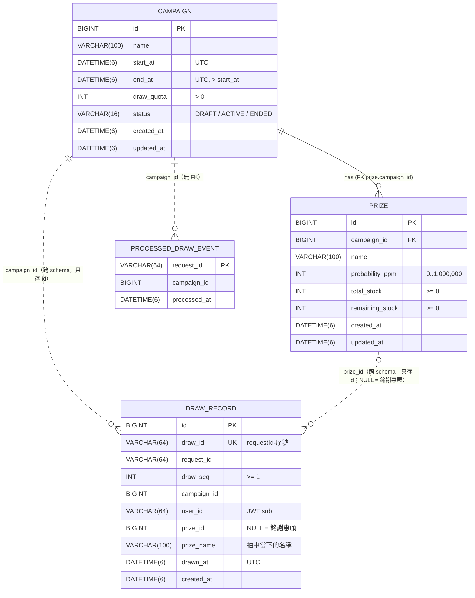

# Table Schema

每個服務在同一個 MySQL instance 中擁有自己的 schema，只存取自己的 schema；服務之間經 API 或 Kafka 溝通。schema 由各服務啟動時以 Flyway 建立（JPA 只做 `validate`），本目錄的 SQL 是 Flyway migration 的彙整：

| Schema | 擁有者 | 檔案 | 內容 |
|---|---|---|---|
| `campaign` | campaign-service | [campaign.sql](campaign.sql) | DDL（`campaign`、`prize`、`processed_draw_event`）+ 範例 DML |
| `record` | record-service | [record.sql](record.sql) | DDL（`draw_record`）+ 範例 DML 與查詢 |

draw-service **沒有資料庫**：抽獎期間的即時狀態都在 Redis（見下方 [Redis 資料結構](#redis-資料結構)）。

## ER 圖



- 實線：同一個 schema 內的外鍵（`prize.campaign_id → campaign.id`）。
- 虛線：**只以 id 參照，沒有外鍵**。`draw_record` 在另一個 schema（另一個服務），`campaign_id`、`prize_id` 只是值；`prize_name` 也一併存下，查紀錄不需要呼叫 campaign-service。`processed_draw_event.campaign_id` 只用於查詢與維運。
- 使用者由 Keycloak 管理，資料庫只存 token 的 `sub`（`draw_record.user_id`），沒有使用者資料表。

## 設計說明

### campaign schema

| 表 | 說明 |
|---|---|
| `campaign` | 抽獎活動。`draw_quota` 是每位使用者的抽獎次數上限；`status` 只能 `DRAFT → ACTIVE → ENDED`，或 `DRAFT → ENDED`。CHECK 保證時間窗合法、次數 > 0。 |
| `prize` | 獎品。機率以整數 `probability_ppm`（1,000,000 = 100%）儲存，API 以百分比（最多 4 位小數）輸入輸出，避免浮點誤差；同一活動的總和 ≤ 1,000,000 由應用程式在每次新增、修改與上線時驗證，剩餘即銘謝惠顧。Prize 順序（id 由小到大）就是機率區間的累加順序。 |
| `processed_draw_event` | `draw.completed` 事件的去重表。主鍵 `request_id`（一筆事件 = 一次抽獎請求）；與扣減 `remaining_stock` 在同一個交易中插入，重複投遞的事件不會重複扣減。 |

庫存欄位：

- `total_stock`：設定的總量，只隨 ADMIN 的增減量改變。
- `remaining_stock`：MySQL 中的剩餘量。活動上線後，**Redis 是剩餘庫存的即時依據**；MySQL 由抽獎事件非同步扣減（最終一致），作為持久副本與 Redis 遺失時重建的來源。
- ADMIN 只能以增減量調整（`total_stock` 與 `remaining_stock` 同時加減），不能直接覆寫，避免蓋掉同時被抽走的數量。

### record schema

| 表 | 說明 |
|---|---|
| `draw_record` | 每一抽（Draw Result）一列。`draw_id`（`<requestId>-<序號>`）UNIQUE，以 `INSERT … ON DUPLICATE KEY UPDATE draw_id = draw_id` 寫入，重複投遞的事件成為 no-op。`prize_id`、`prize_name` 同為 NULL 表示銘謝惠顧（CHECK 保證兩者一致）。 |

索引：

- `idx_draw_record_user_history (campaign_id, user_id, drawn_at, request_id, draw_seq)`：我的紀錄，依時間由新到舊分頁。
- `idx_draw_record_campaign_prize (campaign_id, prize_id)`：後台統計各 Prize 抽出數。

### 時間與字元集

- 所有時間為 UTC 的 `DATETIME(6)`（JDBC `hibernate.jdbc.time_zone=UTC`），API 以 ISO-8601 `Z` 輸出。
- `created_at`、`updated_at` 由資料庫維護。
- 字元集 `utf8mb4`（中文獎品名稱）。

## Redis 資料結構

活動上線（`activate`）時，campaign-service 把設定載入 Redis；抽獎的 Lua script 只讀寫這些 key。每個 key 都帶 `{campaignId}` hash tag，同一活動的所有 key 落在同一個 Redis Cluster slot，Lua script 才能在 Cluster 上原子執行。

| Key | 型別 | 內容 | 寫入者 |
|---|---|---|---|
| `campaign:{id}:meta` | HASH | `status`、`startAt`、`endAt`（epoch 毫秒）、`drawQuota` | campaign-service |
| `campaign:{id}:intervals` | ZSET | member = prizeId，score = 依 Prize 順序累加的 ppm 上界（不含）。種子資料：1 → 10000、2 → 105000、3 → 405000；落點 ≥ 405000 為銘謝惠顧 | campaign-service |
| `campaign:{id}:prize-names` | HASH | prizeId → 名稱 | campaign-service |
| `campaign:{id}:stock` | HASH | prizeId → 即時剩餘庫存 | campaign-service（載入、增減量）、draw-service（抽中扣 1） |
| `campaign:{id}:used:<userId>` | STRING | 使用者已用次數 | draw-service |
| `campaign:{id}:idem:<userId>:<key>` | STRING | 冪等結果（JSON），TTL 24 小時 | draw-service |
| `campaign:{id}:outbox` | STREAM | 待送往 Kafka 的 `draw.completed` 事件；送達後即刪除，長度 = 積壓量 | draw-service |
| `campaign:{id}:outbox:dead` | STREAM | 無法解析、因此無法送出的 outbox 事件（原始欄位 + `outboxId`），供人工檢查 | draw-service |
| `campaigns:live` | SET | 曾載入 Redis 的 campaignId，outbox relay 用來找 stream | campaign-service |

## Kafka 事件

topic `draw.completed`（預設 6 個 partition，key = campaignId），每次成功的抽獎請求一筆：

```json
{
  "campaignId": 1,
  "userId": "0c3f8f6e-2b7a-4f0e-9a51-6d1c2b9e4f10",
  "requestId": "f5a8c065-6a51-470f-9556-6706e1e8bd09",
  "requestedAt": "2026-11-21T03:23:33.803Z",
  "results": [
    { "drawId": "f5a8c065-6a51-470f-9556-6706e1e8bd09-1", "prizeId": null, "prizeName": null },
    { "drawId": "f5a8c065-6a51-470f-9556-6706e1e8bd09-2", "prizeId": 3, "prizeName": "免運券" },
    { "drawId": "f5a8c065-6a51-470f-9556-6706e1e8bd09-3", "prizeId": null, "prizeName": null }
  ]
}
```

| 消費者（consumer group） | 寫入 | 去重 |
|---|---|---|
| `record-service` | `record.draw_record`（每個 result 一列） | `draw_id` UNIQUE |
| `campaign-service` | `campaign.prize.remaining_stock` 扣減 | `processed_draw_event.request_id` |

無法解析或內容不合法的訊息送到各自的 dead-letter topic（`draw.completed.record-service.DLT`、`draw.completed.campaign-service.DLT`）；因為消費端冪等，修正後重新投遞是安全的。
